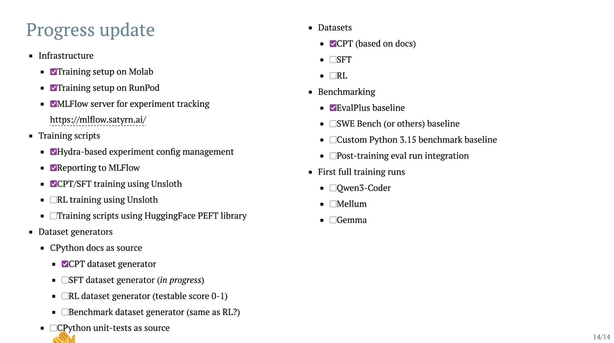

# Satyrn Plaza Kickoff

Welcome to the first Satyrn Plaza!

Since there are quite a few people on the server, we'd like to get to know each other better and share some updates on the overall progress! 🙂

The meeting will take place on Thursday, August 13 at 6 PM CET.

Grab your favorite drink, and see you all on Thursday! 🥂

## Introduction [5-10 minutes]

Laura Summers will lead an introduction to Project Satyrn.

## Team Lead Introductions [3-5 minutes each]

Team leads sharing: what we’ve done, what we’re doing now, where you can help.

### Model Team - Michał Karzyński

### Engine Team - Łukasz Zieniewicz

- A repository for aggregating and easily running eval benchmarks created by all members of Satyrn community: [Satyrn Evals](https://github.com/satyrn-ai/satyrn-evals) - submit ideas there

### Web Team - Laura Summers

- design work in-flight
- PR with a multi-author blog is ready thanks to Mike Fiedler's work
- HTML, CSS, JS experience - if you have it, join us
- if you have love for writing blog posts, we could use someone to help sharing progress of various teams

### Code of Conduct Team - Emma Cooke

- we have one! [CoC](https://satyrn-ai.github.io/team-compass/conduct/code_of_conduct/?h=code+of+conduct#expected-behaviours)
- please report incidents to `coc@satyrn.ai`

### Education Team - Carol Willing

- creating howto's, tutorials, educational materials to share with the community
- bringing in the wider community to create content
- Emma kicked off a [jargon buster document](https://satyrn-ai.github.io/satyrn-zen/learn/glossary/)

### Infrastructure Team - Pelle Koster

- DNS, GitHub, infrastucture setup

### Organizers Team - Emma/Daria

- Carol kicked off [Satyrn Team Compass](https://satyrn-ai.github.io/team-compass/) and [Satyrn Zen](https://satyrn-ai.github.io/satyrn-zen/)

## Q&A and a discussion

Discussions and questions.
